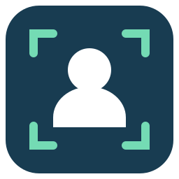

<p align="center">
  
</p>

<h1 align="center">Subjector</h1>

<p align="center">
  <strong>Copy the subject. Leave the background.</strong><br>
  Background removal straight to your Linux clipboard.
</p>

<p align="center">
  
  
  
</p>

<p align="center">
  <a href="#get-started">Get started</a> ·
  <a href="#appimage">AppImage</a> ·
  <a href="#how-it-works">How it works</a> ·
  <a href="#contributing">Contributing</a>
</p>

---

Subjector brings the idea of macOS **Copy Subject** to Linux. Choose a photo, remove its background with [rembg](https://github.com/danielgatis/rembg), and paste the subject into an image editor or document.

**Your images stay on your computer. Your original files stay unchanged.**

> **Early testing build.** Tested on Bazzite with KDE Plasma, Dolphin, Wayland, and an NVIDIA RTX 3060. Other distributions and desktops are not yet verified. Bug reports and small improvements are welcome.

## What it does

| | Feature |
| :--- | :--- |
| **Copy, then paste** | Places a transparent PNG on the clipboard—not a file path. |
| **Right-click workflow** | Open an image with Subjector, or enable Dolphin’s optional **Copy subject** action. |
| **Local inference** | No image uploads, accounts, or cloud processing. Works offline after setup. |
| **Prompted setup** | Downloads rembg, a private Python runtime, and model dependencies after approval. |
| **GPU when available** | Verifies real NVIDIA CUDA inference and falls back to CPU when needed. |
| **Recovery controls** | Update, repair, select CPU-only setup, or restore the previous runtime. |

## Get started

### Requirements

- Linux **x86_64**, with **KDE Plasma / Dolphin on Wayland**.
- Host tools: `kdialog`, `qdbus`, and `wl-copy`.
- Python **3.11+** for a source launch. The AppImage includes its own Python.
- Internet for initial setup. Allow about **1 GB for CPU**, or **several GB for CUDA**.

These host tools are present on the tested Bazzite machine. A fully self-contained, cross-distribution build is still a work in progress.

### Run from a checkout

```sh
./subjector.sh
```

1. Select **Choose an image and copy its subject**.
2. Choose a JPEG, PNG, or static WebP photo with a clear foreground subject.
3. On first use, approve the metadata check and software downloads. Check the approval box in each consent dialog.
4. Wait for **Subject copied**, then press **Ctrl+V** in an application that accepts images.

For a smaller initial download, choose **Set up / repair using CPU only** first. Automatic setup attempts CUDA on detected NVIDIA hardware.

You can also open an image directly:

```sh
./subjector.sh "/path/to/photo.jpg"
```

### Add the right-click actions

In Subjector’s menu, select:

- **Add Subjector to Open With** → Dolphin’s **Open With → Subjector**.
- **Enable Dolphin: Copy subject** → a one-image right-click action, sometimes under **Actions**.

Neither option changes your default image viewer. Both have removal options in the menu. Reopen Dolphin if a newly enabled action does not appear.

## AppImage

An **unsigned test AppImage** is available through the local build process below. It contains the application and bootstrap Python, but still uses the host’s KDE/clipboard helpers.

After building—or receiving a test artifact—put it somewhere permanent:

```sh
mkdir -p ~/Applications
cp dist/Subjector-x86_64.AppImage ~/Applications/Subjector.AppImage
chmod +x ~/Applications/Subjector.AppImage
~/Applications/Subjector.AppImage
```

The image runs independently of this checkout and reuses existing Subjector runtimes. Register desktop integration **after** placing it at its permanent path:

```sh
~/Applications/Subjector.AppImage integrate
~/Applications/Subjector.AppImage integrate --context-menu
```

Add `--remove` to either command to remove that entry. The same controls are in the GUI. If you move the AppImage, register again from the new location.

<details>
<summary><strong>Build, verify, and update an AppImage</strong></summary>

Build on Linux x86_64 with Python 3.11+:

```sh
python3 scripts/build_appimage.py
```

If setup already downloaded the bootstrap Python, reuse it:

```sh
python3 scripts/build_appimage.py \
  --python-archive ~/.cache/subjector/python-3.13.16.tar.gz
```

Run one build command, not both. The builder refuses to overwrite an existing artifact. Move the old output aside or pass `--output /another/path/Subjector.AppImage`.

Outputs:

- `dist/Subjector-x86_64.AppImage`
- `dist/Subjector-x86_64.AppImage.sha256`

Check the artifact before copying it:

```sh
cd dist
sha256sum -c Subjector-x86_64.AppImage.sha256
```

Build inputs have pinned SHA-256 checksums. The builder includes `BUILD.json` and third-party notices, but excludes user data, inference runtimes, models, tests, and repository metadata.

To update application code, close Subjector and replace the image at the same permanent path. Keep the previous image if you want to revert. Do not replace it during setup or image processing.

AppImage replacement and inference-runtime updates are separate. Runtime rollback does not restore an older AppImage. There is no automatic AppImage updater or signing yet.

If FUSE is unavailable:

```sh
~/Applications/Subjector.AppImage --appimage-extract-and-run
```

Building also uses extract-and-run and does not require FUSE.

</details>

## How it works

**Image → local rembg inference → transparent PNG → clipboard**

First setup checks PyPI for the latest stable rembg release, then installs it into an application-owned runtime. Python and model downloads have pinned SHA-256 checksums. Setup activates a runtime only after inference validation succeeds.

The current model is **U2Netp**, chosen for its small download. Output keeps the image’s oriented dimensions and existing transparency, while removing EXIF metadata.

NVIDIA setup requires profile evidence of CUDA kernel execution—not just a detected GPU. Failed GPU setup installs a separate CPU runtime. GPU errors during copying retry on CPU and save the fallback for later copies.

AMD, Intel, and undetected GPUs use CPU. Subjector does not change system Python or install GPU drivers. Clipboard ownership continues after the application exits.

<details>
<summary><strong>Downloads and local storage</strong></summary>

Setup downloads Python 3.13.16 (about 35 MB), U2Netp weights (about 4.6 MB), rembg, and the selected backend’s dependencies. Sources are PyPI, Python-hosted packages, and official GitHub release assets.

The verified rembg 2.0.86 installation used about **692 MiB for CPU** and **3.0 GiB for CUDA**. Future dependency versions can differ. The AppImage is about **32 MB** and does not bundle those inference dependencies.

Default paths respect XDG overrides:

| Data | Default location |
| :--- | :--- |
| Runtimes and models | `~/.local/share/subjector/` |
| Download cache | `~/.cache/subjector/` |
| Open With entry | `~/.local/share/applications/subjector.desktop` |
| Dolphin action | `~/.local/share/kio/servicemenus/subjector.desktop` |

To uninstall, remove both desktop integrations using Subjector, then remove its runtime/cache directories and the AppImage or checkout. Original images are not stored in those directories.

</details>

## Current limits

- One static JPEG, PNG, or WebP at a time: at most **50 MiB** and **25 million pixels**.
- No manual subject selection, automatic crop, batch processing, X11, or other file-manager integrations.
- Fine hair, busy backgrounds, and small objects can challenge the lightweight model. This is not a promise of Apple-quality results.
- Cancel or close the progress window to stop an operation. A blocked network read can take up to its socket timeout to stop.
- Clean-system portability, broader quality testing, and the final licensing/security review remain open. This is not a production-ready release.

## Troubleshooting

Use **Show runtime / GPU status** in the GUI, or run:

```sh
~/Applications/Subjector.AppImage --version
~/Applications/Subjector.AppImage doctor
```

`doctor` is offline and read-only. If pasting appears to do nothing, try an image editor rather than a plain-text field.

Use **Update or repair the runtime** for a fresh installation, or the CPU-only option for GPU trouble. A successful update retains the previous runtime; **Restore the previous runtime** switches back without downloads.

<details>
<summary><strong>Terminal commands</strong></summary>

From a checkout:

```sh
python3 -m subjector setup --check
python3 -m subjector setup --install
python3 -m subjector setup --install --cpu
python3 -m subjector copy -- "/path/to/photo.jpg"
python3 -m subjector update
python3 -m subjector repair --cpu
python3 -m subjector rollback
```

For an AppImage, replace `python3 -m subjector` with its executable path. `setup --check` retrieves metadata only, after permission. Normal image copying reuses the installed runtime offline.

Bazzite’s `/home` → `/var/home` prefix mismatch is fixed. If an older build failed with a prefix/script-path error, retry setup with the current build. There is no need to delete the verified download cache.

</details>

### Run the tests

The default suite does not download models or change the clipboard:

```sh
python3 -m unittest discover -s tests -v
```

Real image tests require a prepared runtime. Use the **Active runtime** path from `doctor`:

```sh
SUBJECTOR_TEST_RUNTIME="/path/to/subjector/versions/runtime-id" \
  python3 -m unittest discover -s tests -v
```

Real-runtime tests create temporary images without writing to the clipboard. Local verification covered CPU/CUDA inference, rollback, offline reuse, AppImage relocation, Open With, and normal Wayland clipboard output.

Please test visual paste behavior and Dolphin’s actual menu interaction too. Automated checks do not replace those acceptance tests.

## Credits & licensing

Subjector builds on:

- [rembg](https://github.com/danielgatis/rembg) — background removal, MIT license.
- [U²-Net](https://github.com/xuebinqin/U-2-Net) — segmentation project, Apache-2.0 source license. Model weights come from rembg release assets.
- [python-build-standalone](https://github.com/astral-sh/python-build-standalone) — private Python distributions.
- [AppImage](https://appimage.org/) — portable application format and build tooling.

Upstream licenses apply to bundled and downloaded components. See the [AppImage third-party notices](packaging/appimage/THIRD_PARTY.md) for details and outstanding review work.

**Subjector does not yet include its own license.** A project license must be selected before others can rely on permission to reuse or redistribute its code.
